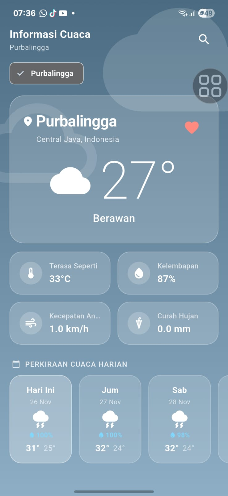

# Respons I Flutter - Aplikasi Informasi Cuaca

Aplikasi Informasi Cuaca berbasis Flutter yang mengambil data perkiraan cuaca dan pencarian lokasi secara real-time dari REST API Open-Meteo. Aplikasi dibangun menggunakan arsitektur **Model-View-ViewModel (MVVM)** dengan penyimpanan lokal (**SharedPreferences**).

---

## 1. Struktur Aplikasi

Proyek disusun dengan pemisahan tanggung jawab yang jelas berdasarkan pola MVVM:

```
lib/
├── models/
│   ├── location_model.dart             # Model data lokasi / kota (Geocoding API)
│   └── weather_model.dart              # Model data cuaca terkini & harian (Weather Forecast API)
├── services/
│   ├── api_service.dart                # Service HTTP Request GET ke Open-Meteo API
│   └── local_storage_service.dart       # Service penyimpanan lokal (SharedPreferences)
├── viewmodels/
│   └── weather_viewmodel.dart          # ViewModel pengelola State & logika bisnis aplikasi
├── views/
│   ├── home_screen.dart                # Tampilan utama cuaca terkini & prakiraan harian
│   └── search_screen.dart              # Tampilan pencarian kota & daftar favorit
├── widgets/
│   ├── current_weather_section.dart    # Komponen kartu hero cuaca saat ini
│   ├── daily_forecast_card.dart        # Komponen kartu cuaca harian (7 Hari)
│   ├── weather_info_card.dart          # Komponen metrik cuaca (kelembapan, angin, dll)
│   └── weather_background_widget.dart  # Komponen atmosfer cuaca dinamis (siang/malam & animasi)
└── main.dart                           # Entry point aplikasi & Provider initialization
```

---

## 2. Penerapan MVVM (Model-View-ViewModel)

1. **Model**:
   - `LocationModel`: Memetakan data lokasi dari Geocoding API (`name`, `country`, `admin1`, `latitude`, `longitude`, `isFavorite`).
   - `WeatherModel`: Memetakan data cuaca dari Weather Forecast API (`current` & `daily`) serta konversi kode cuaca WMO ke deskripsi dan icon.

2. **ViewModel**:
   - `WeatherViewModel`: Mewarisi `ChangeNotifier` untuk mengelola state reaktif aplikasi:
     - `fetchWeatherForCurrentLocation()`: Memanggil data cuaca lokasi terpilih.
     - `searchCities()`: Menjalankan pencarian kota via REST API.
     - `toggleFavorite()`: Menambah / menghapus lokasi favorit ke penyimpanan lokal.
     - `selectLocation()`: Mengganti kota aktif dan menyimpan riwayat lokasi terakhir.

3. **View**:
   - `HomeScreen`: Menampilkan informasi kota terpilih, suhu saat ini, kelembapan, kecepatan angin, curah hujan, suhu yang dirasakan, serta perkiraan cuaca 7 hari ke depan dengan latar atmosfer dinamis. Menggunakan `Consumer<WeatherViewModel>` untuk pembaharuan tampilan otomatis.
   - `SearchScreen`: Menyediakan input pencarian kota real-time, menampilkan hasil dari API, serta daftar lokasi favorit yang tersimpan.

---

## 3. Implementasi REST API Open-Meteo

Menggunakan package `http` untuk mengirim permintaan `GET` secara asinkron:

1. **Geocoding API**:
   - Endpoint: `https://geocoding-api.open-meteo.com/v1/search?name={city}&count=10&language=en&format=json`
   - Digunakan untuk pencarian koordinat latitude dan longitude berdasarkan nama kota.

2. **Weather Forecast API**:
   - Endpoint: `https://api.open-meteo.com/v1/forecast?latitude={lat}&longitude={lon}&current=temperature_2m,relative_humidity_2m,apparent_temperature,precipitation,weather_code,wind_speed_10m,is_day&daily=temperature_2m_max,temperature_2m_min,precipitation_probability_max,weather_code&timezone=auto`
   - Parameter & Field yang diambil:
     - **Suhu saat ini**: `current.temperature_2m`
     - **Kelembapan**: `current.relative_humidity_2m`
     - **Suhu yang dirasakan**: `current.apparent_temperature`
     - **Curah hujan**: `current.precipitation`
     - **Kode cuaca**: `current.weather_code`
     - **Kecepatan angin**: `current.wind_speed_10m`
     - **Status siang/malam**: `current.is_day`
     - **Suhu maks & min harian**: `daily.temperature_2m_max`, `daily.temperature_2m_min`
     - **Peluang hujan maks**: `daily.precipitation_probability_max`

---

## 4. Fitur Penyimpanan Lokal (Local Storage)

Menggunakan package `shared_preferences` untuk menyimpan:
1. **Lokasi Favorit**: Daftar kota favorit disimpan dalam format JSON.
2. **Lokasi Terakhir**: Kota yang dipilih terakhir kali disimpan agar langsung dibuka saat aplikasi dijalankan kembali.

---

## 5. Screenshot Aplikasi

| Home / Weather Screen | Search & Favorites Screen |
| :---: | :---: |
|  |  |
